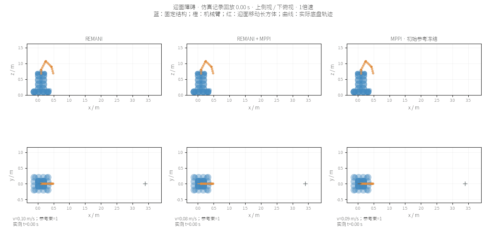

# 迎面动态障碍：REMANI / REMANI＋MPPI / 冻结初始参考 MPPI

本页对应 2026-11-18 新完成的迎面障碍仿真。代码版本 `20261118-230546-headon-bypass-timing`，可回退父版本 `20261118-225711-headon-bypass-attempt`。这是历史 ROS 数值仿真框架的改进，未同步到实车。



- [数据曲线](experiments/online_remani_validation/results/headon_bypass_timing_20261118-225726/report/comparison.png)
- [联合组 GIF](experiments/online_remani_validation/results/headon_bypass_timing_20261118-225726/report/mppi/comparison.gif) · [冻结参考组 GIF](experiments/online_remani_validation/results/headon_bypass_timing_20261118-225726/report/fast_only/comparison.gif)
- [实验说明与限制](experiments/online_remani_validation/results/headon_bypass_timing_20261118-225726/README.txt) · [结果摘要](experiments/online_remani_validation/results/headon_bypass_timing_20261118-225726/run_summary.json)
- [实际运行的 MPPI 内核](experiments/online_remani_validation/results/headon_bypass_timing_20261118-225726/mppi/runtime/active_arm_mppi.py) · [控制节点](experiments/online_remani_validation/results/headon_bypass_timing_20261118-225726/mppi/runtime/active_arm_node.py)
- [离线报告脚本](experiments/online_remani_validation/results/headon_bypass_timing_20261118-225726/setup/report_comparison.py)

| 组别 | 结果 | 实际路程 | 从开始运动到完成 | 最小外部间隙 |
|---|---|---:|---:|---:|
| REMANI 原生控制对照 | 碰撞终止 | 1.407 m（未完成） | 8.61 s（碰撞） | 已碰撞 |
| REMANI＋MPPI | 避障并到达 | 3.930 m | 28.72 s | 0.1384 m |
| 冻结初始参考＋MPPI | 避障并到达 | 3.999 m | 25.17 s | 0.1149 m |

每组仅一轮；原生对照复用本次同条件前一轮记录。不可据此泛化算法排名。冻结仅停止后续慢层换轨，MPPI仍实时采样和控制；本轮快层首次绕行比新慢层参考交付早约9.04秒。

## 场景与修复

机器人运动后出现0.4×0.4×1.45米长方体，以0.18 m/s迎面移动。各组共享初始姿态、目标、限速和传感器模式，底盘自由运动。机器人使用47个固定结构球和20个机械臂球；场景真值仅用于合成传感和独立碰撞核查。

本轮修复动态预测2秒覆盖与完整制动时间冲突、原偏航候选侧移不足，以及新绕行参考错误沿用直行参考时长导致反复换侧。根据观测点云包络构造左右绕行参考，按实际所选参考计算有效时长；保留完整制动和交付检验。9项离线检查通过后两组MPPI闭环到达。

## 尚未解决

联合组仍有慢层同步求解阻塞快照内部采样的问题，记录到26次快照无效；不能称卡顿已全部修好。快层前缀进入过慢层初值，但本次使用前缀的优化未通过，成功换轨未使用前缀。1.1秒交接目标超过0.6–0.7秒有效控制段，软耦合代价未激活。因此尚未验证完整双时间尺度耦合优化收益。

## 文件与复现边界

四轮目录均保留：

1. [`headon_threeway_20261118-210617`](experiments/online_remani_validation/results/headon_threeway_20261118-210617)：原始三组失败和GIF。
2. [`headon_window_repair_20261118-223634`](experiments/online_remani_validation/results/headon_window_repair_20261118-223634)：时间覆盖修复后的失败记录。
3. [`headon_bypass_repair_20261118-224725`](experiments/online_remani_validation/results/headon_bypass_repair_20261118-224725)：真实绕行候选及首次时长匹配失败。
4. [`headon_bypass_timing_20261118-225726`](experiments/online_remani_validation/results/headon_bypass_timing_20261118-225726)：最终成功的两组MPPI及对照GIF。

每轮包含实际运行的Python、launch、参数、模型、manifest、状态CSV、动态障碍CSV、控制周期及慢层时序，保留失败与首次干预输入。`bin`提供本机ARM64实际执行文件用于对应源码核查，不代表跨平台可执行；相关C++源码快照在`experiments/online_remani_validation/builds`指定两处的`source`中。不包含编译缓存、ROS_HOME、日常ROS日志或实车环境。

原始JSON、launch和参数保留 `/home/l/remani_ws` 绝对路径，以保持记录哈希；发布时仅把包内链接转成仓库内相对链接。新设备重跑需先复制到新案例目录、重定位配置路径并重新生成输入manifest，不能直接覆盖已完成结果。原ROS Noetic/ARM64环境与系统依赖不包含在此上传。

在原路径及Python依赖（numpy/scipy/PyYAML/matplotlib/Pillow）满足时，以下命令仅重绘已保存数据，不控制机器人：

```bash
OPENBLAS_NUM_THREADS=1 OMP_NUM_THREADS=1 MPLBACKEND=Agg /usr/bin/python3 experiments/online_remani_validation/results/headon_bypass_timing_20261118-225726/setup/report_comparison.py --case experiments/online_remani_validation/results/headon_bypass_timing_20261118-225726 --max-frames 160
```

对应的9项离线检查位于`experiments/online_remani_validation/results/headon_bypass_timing_20261118-225726/setup/test_prediction_coverage.py`和`test_bypass_reference.py`。历史闭环启动脚本仅允许localhost:11441隔离仿真，且拒绝覆盖已有结果；本次上传不启动ROS或实车。
