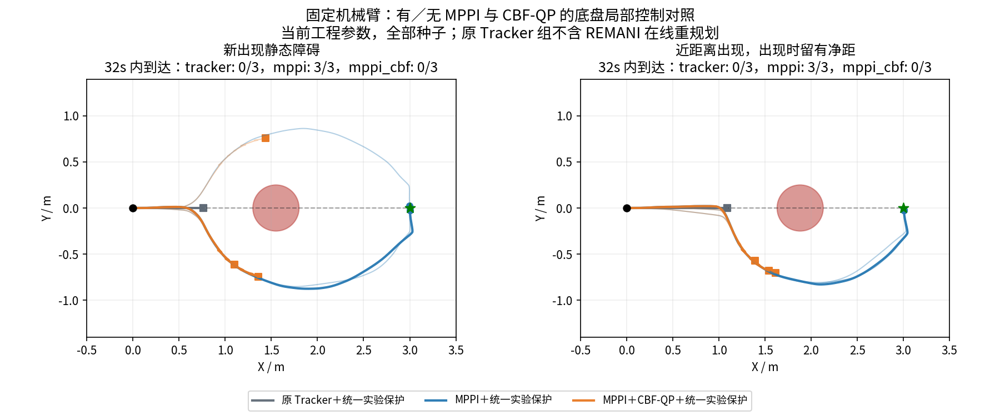
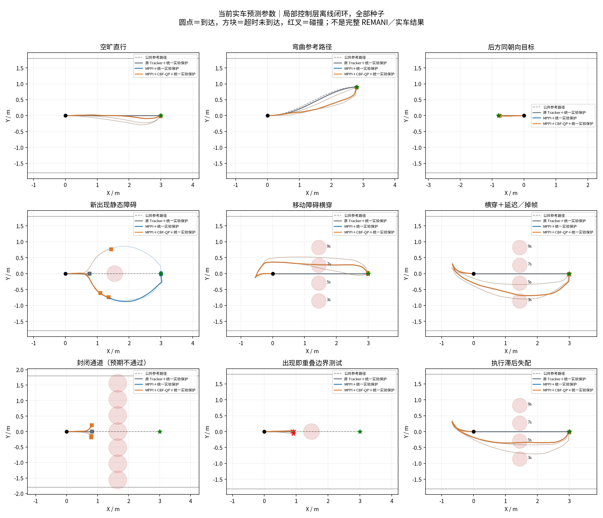
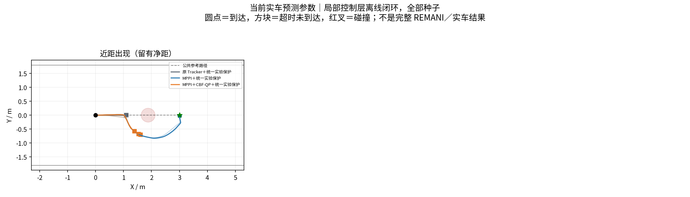
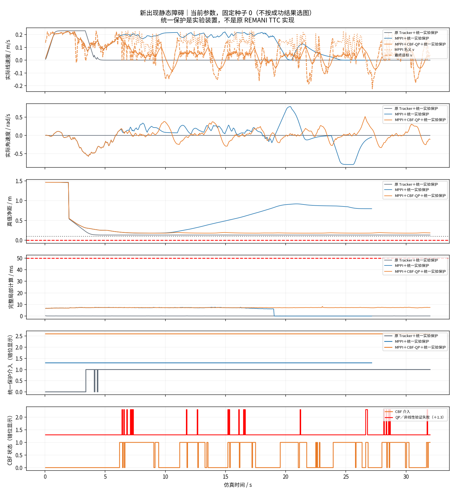
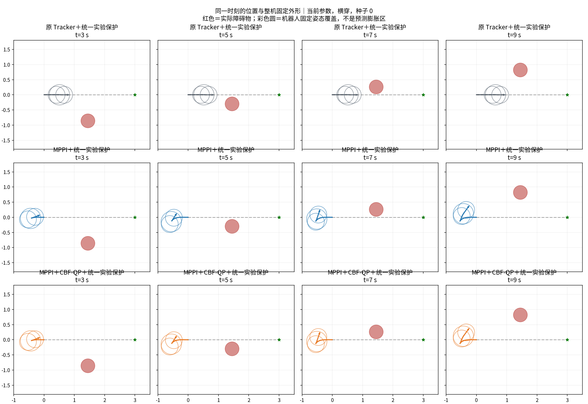
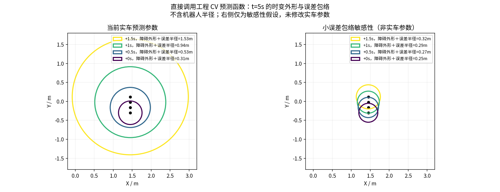

# 本轮结论：MPPI 有局部绕行能力，当前串联 CBF-QP 没有通过行为验证

完成 117 次数值闭环：首批 108 次在 `results/full_01/`，非重叠近距离场景补充 9 次在 `results/close_clearance_01/`。原实车源码、launch、驱动未修改，未发送控制指令。

## 先看结果

同步动画：[新静态障碍三组对照](results/full_01/animation_new_static_workspace.gif)、[横穿三组对照](results/full_01/animation_crossing_workspace.gif)。动画使用固定种子 0，不按成功结果选取。

下表均使用**当前实车参数**，每项 3 个种子，成功要求 32 s 内满足位置、朝向和低速条件。

|场景|原 Tracker＋统一实验保护|MPPI＋统一实验保护|MPPI＋CBF-QP＋统一实验保护|
|---|---:|---:|---:|
|空旷直行|3/3|3/3|3/3|
|弯曲参考路径|3/3|3/3|3/3|
|后方同朝向目标|3/3|3/3|3/3|
|新出现静态障碍|0/3|3/3|0/3|
|移动障碍横穿|3/3|2/3|2/3|
|横穿＋延迟／掉帧|3/3|1/3|1/3|
|执行滞后失配|3/3|2/3|2/3|
|补充：近距离出现且留有净距|0/3|3/3|0/3|
|封闭通道|0/3，符合预期|0/3，符合预期|0/3，符合预期|

**原 Tracker 组没有运行 REMANI 在线重规划。** 它在静态障碍前停住只说明“跟踪固定参考＋实验保护”不会自己绕行，不能说原版 REMANI 不会绕行。确定性 Tracker 重复种子只为配对，不是 3 个独立随机样本。

## 为什么不能直接说 MPPI+CBF 更好

1. **增加局部 MPPI 的确产生了绕行动作。** 新静态障碍和非重叠近距离场景，MPPI-only 共 6/6 次到达，最小真值净距约 0.180 m。这里的“真值”指合成场景的真实几何，不是实车。
2. **现有 CBF 串联明显降低了这两类场景的通行能力。** 新静态障碍出现 353 个 QP/原非线性约束验证失败周期，补充近距离场景出现 498 个；合计 851 个。不能把这些失败归咎于计算超时，本轮对应测试没有超出 50 ms 周期。
3. **CBF 介入并非只发生在失败周期。** 新静态障碍种子 0 的组合控制有 289 个干预周期，第一次过滤失败在 CSV 6.4 s（控制区间 6.35–6.40 s）；到 32 s 仍在障碍侧面附近，而 MPPI-only 在 27.15 s 满足到达条件。证据见下图和原始 CSV。
4. **当前大预测包络会把“停车”等待变成“绕远/后退”，但不一定更快到达。** 当前横穿场景 Tracker 停留均值 5.10 s，而 MPPI 为 0.88 s；但 MPPI 只到达 2/3 次，不能仅凭少停车就说全面改善。
5. **较小预测包络只是敏感性分析。** 三类移动障碍在该假设下 MPPI 与组合控制均 9/9 次到达，但 CBF 没有实际介入，因此不能把成功归功于 CBF，更不能冒充当前实车感知效果。

## 碰撞与边界，不能隐藏也不能误读

- 当前参数的普通场景和非重叠补充场景，本批没有检测到模型碰撞；这不是安全证明。
- 首批 `late_intrusion` 的 9 次运行全部在障碍出现瞬间发生覆盖几何重叠。障碍在 4.5 s 才存在，碰撞就在 4.5 s 发生，尚没有新控制响应机会。此项单列为“出现即重叠边界”，不能计入普通可避让成功率或据此判断反应速度。
- 小误差敏感性下，原 Tracker＋实验保护出现 9 次模型碰撞。停止的机器人仍可能被持续接近的障碍撞到，说明实验保护不构成安全保证；这**不是**生产 REMANI 安全链路的测试结果。
- 初次小样本的终点未收敛结果保留在 `smoke_01/`、`smoke_02/`。最终版通过独立终点位置/朝向控制消除基础收敛问题，没有放宽到点容差；完整批次开始后未再按结果调参。

## 计算可行性与可靠性

首批 108 次局部完整计算：

|方法|周期数|P95|最大|
|---|---:|---:|---:|
|原 Tracker 适配|10,569|0.132 ms|0.580 ms|
|MPPI|16,581|8.526 ms|10.728 ms|
|MPPI＋CBF-QP|16,898|8.534 ms|9.445 ms|

这些数值不含真实点云、ESDF、ROS 调度或底盘通信，是计算可行性筛选，不是实车实时性保证。实车 Tracker 配置为 50 Hz，本实验统一按 20 Hz 调用各组控制器，不能混淆。

- 117 条轨迹通过速度、轮速、加速度、目标、碰撞、过滤失败和时限统计一致性检查。
- 独立 Python 实现重积分全部种子 0：39 条轨迹、16,840 个控制周期、168,400 个 5 ms 物理步，状态与净距误差均小于 1e-10。
- 原 Tracker 内存适配通过 5 项测试，测试期间显式禁止 Python socket；检查前进、倒退、原地转向、定位过期和安全限速。
- 源码/参数哈希、编译命令、逐周期 CSV、原计算动态库和源码快照均保留。首批源码快照为 `full_01/source_snapshot/`；补充批保留完整相对路径快照。

## 下一步建议

此次验证支持“继续接入 MPPI 局部控制实验”，**不支持把当前 MPPI+CBF 原型直接接管实车**。需要先解决：

1. 分离并校准动态预测外形和误差包络，量化预测精度；不能单纯缩小半径换取好看结果。
2. 检查 CBF 与差速可达动作、短时执行滞后、MPPI 滚动轨迹的一致性；对比 CBF-aware rollout，而不是继续叠加一个会反复拦停的输出过滤器。
3. 做完整 REMANI 在线重规划的同场景对照，才能回答“相对当前系统到底改善多少”。

本轮只新增实验目录，不修改实车。使用和回退见 [README.md](README.md)。
