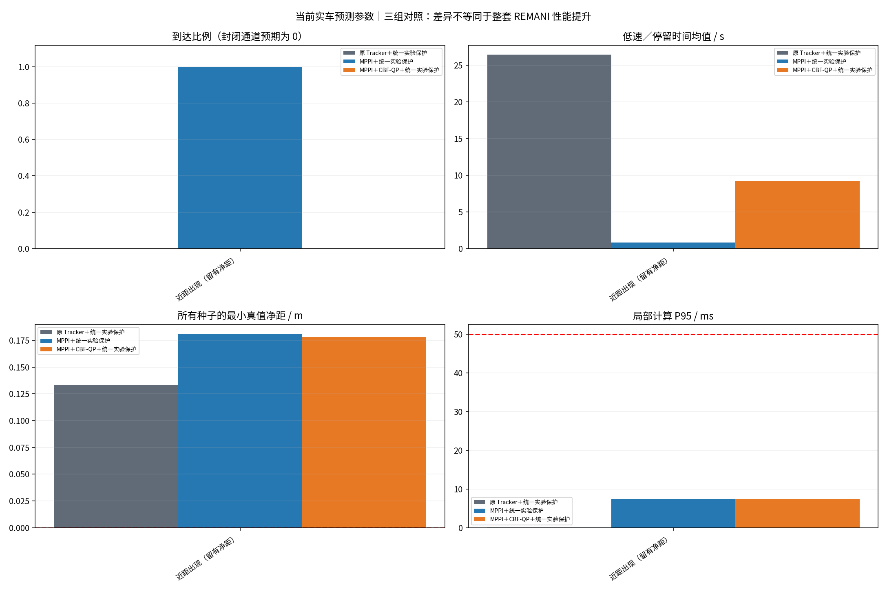

# 固定机械臂：底盘 MPPI / CBF-QP 三组对照

这是算法层离线数值闭环，不是 Gazebo、实车或完整 REMANI 的 A/B 测试。全部图片来自本批 CSV。

## 对照口径

- 无 MPPI：直接执行工程 RealBaseTracker 类，ROS 传输替换为内存；参考点由统一几何路径适配器生成。
- 有 MPPI：同一路径作为软参考，允许局部偏离；不是重新运行 REMANI 搜索/轨迹优化。
- MPPI+CBF-QP：同一 MPPI 后接离散数值线性化屏障 QP，原始非线性约束复验。
- 两个 MPPI 模式均包含终点位置／朝向分阶段收敛控制；切换半径为 max(0.20 m, 可用直行上限×预测时域)，仍通过各自过滤与统一保护，不是纯采样控制包办所有状态。
- 三组均经过同一个实验保护：0.15 s 反应段＋制动预测检查，过期/超时请求制动。它不是生产 TTC 代码。
- 原 Tracker 没有配上 REMANI 在线重规划；其绕不过静态障碍不能解释为原 REMANI 绕不过。
- 封闭通道不应通过；必要等待、原地转向均计入低线速度时长，不能全部算误停。

边界场景 late_intrusion 在 t=4.5 s 把障碍物直接放到已与机器人覆盖外形重叠的位置；本批此项碰撞发生在任何新控制响应之前，不能用它衡量反应速度。它的原始结果保留，不计作普通可避让成功率。close_clearance 是新增补充场景，同样在 4.5 s 出现但 x=1.88 m，须另看其出现时的实际净距。

## 工程关联与未复用部分

- 读取 exp0_real.launch 的最终解析参数，导出 effective_real_params.json，而非只读 YAML 默认值。
- 直接编译调用 DynamicPointBuffer 的 CV 与误差包络函数；未启动节点，未运行检测/聚类/关联或 ESDF。
- 固定机械臂使用当前初始关节角和 Piper DH 采样投影；额外工具余量 0.10 m 未经实车 mesh 标定。
- 合成障碍用圆形完整外形，静态地图用墙/圆几何；并非实际点云，更不是把每个雷达点都当独立目标。
- 同时满足 Tracker 速度上限 0.300 m/s、0.800 rad/s，以及左右轮线速度 0.2296 m/s、轮线加速度 0.2975 m/s²；因此直行实际可用上限不是 0.30 m/s。
- 统一安全余量取工程底盘/机械臂余量的较大值 0.100 m（二维投影保守近似）。
- 三组统一按 20 Hz 评估；生产 Tracker 定时器是 50 Hz。原类控制循环被同步调用，没有复现真实线程调度。
- 控制器执行滞后假设 0.12 s；lag_mismatch 真值滞后 0.28 s。都不是实车辨识结果。
- workspace 全部使用当前误差参数；sensitivity 仅修改离线假设，用来分析保守性，不能当作实车效果。
- 真值碰撞独立按 5 ms 检查；到达同时检查位置、朝向和速度。CSV 每条记录是区间末状态，控制量作用于刚结束的区间。
- 计算耗时含合成观测、预测/采样/过滤/共同保护，未包含 ROS、ESDF、点云处理、串口；不是实车实时保证。
- QP 失败或下游保护改变动作后，不把原 CBF 检查当作最终动作的安全认证。

## 图片

本批不含横穿场景，无横穿快照。

本批不含横穿预测包络对照。

## 完整统计（不删除失败种子）

|参数组|场景|方法|到达/次数|碰撞|停留均值 s|最小净距 m|P95/P99/max ms|QP失败|保护周期|超时|
|---|---|---|---:|---:|---:|---:|---:|---:|---:|---:|
|workspace|近距出现（留有净距）|tracker|0/3|0|26.40|0.133|0.13/0.15/0.27|0|1626|0|
|workspace|近距出现（留有净距）|mppi|3/3|0|0.83|0.181|7.39/7.44/7.46|0|0|0|
|workspace|近距出现（留有净距）|mppi_cbf|0/3|0|9.22|0.178|7.46/7.52/7.59|498|0|0|

## 能与不能得出的结论

可以比较：固定参考任务下，增加局部采样控制/安全过滤后，本批场景的到达、净距、停留、计算时间如何变化。
不能宣称：超过完整 REMANI baseline、实车能立即避让、CBF 保证无碰撞、预测器精度已验证。
当前是启发候选引导的采样加权 MPPI 原型；CBF 是顺序线性化的离散屏障实验，不是全时域鲁棒安全证明。
如果 MPPI+CBF 比 MPPI 更慢或更容易停车，需分析模型一致性、约束可行性和预测包络，而不能隐藏该结果。

## 可复现与回退

manifest.json 保留代码与生产配置哈希、编译命令、运行参数。verification.txt 为独立数值一致性检查。
只新增 experiments/base_mppi_cbf_compare/；不修改 src/、实车 launch 或驱动，不连接 ROS master。移走新增目录即可撤回本轮实验。
