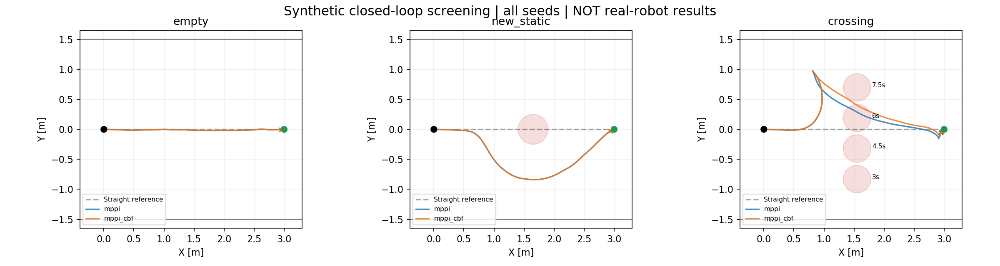
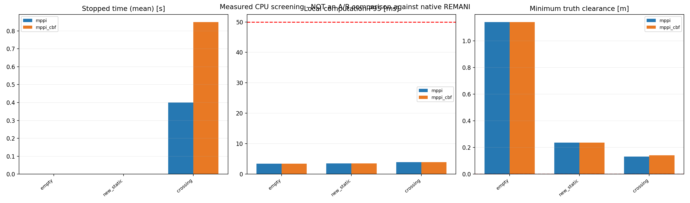

# MPPI / CBF-QP 独立可行性筛选报告

结果由实际运行 CSV 自动生成；没有发送控制指令，也未修改实车启动链路。
固定机械臂姿态的二维投影闭环实验，不是全身实车验证，不是原生 REMANI 的公平 A/B。

碰撞运行 0 次；计算超时周期 0 次；QP 无解/验证失败周期 18 次。
出现碰撞、QP 无解或大量非必要停车时，不能宣称已实现安全实时避障。

## 图片

轨迹图包含全部种子；详情图固定为种子 0，不按成功结果选图。红色圆为标注时刻的障碍物外形，不是整个时域同时占据。

## 统计

|场景|方法|到达/次数|碰撞|平均停车 s|最小净距 m|P95 ms|P99 ms|QP 失败周期|超时周期|
|---|---|---:|---:|---:|---:|---:|---:|---:|---:|
|empty|mppi|1/1|0|0.00|1.142|3.42|3.45|0|0|
|empty|mppi_cbf|1/1|0|0.00|1.142|3.42|3.45|0|0|
|new_static|mppi|1/1|0|0.00|0.236|3.55|3.59|0|0|
|new_static|mppi_cbf|1/1|0|0.00|0.236|3.55|3.59|0|0|
|crossing|mppi|1/1|0|0.40|0.133|3.96|3.98|0|0|
|crossing|mppi_cbf|1/1|0|0.85|0.142|3.96|3.97|18|0|

## 口径与限制

- blocked 预期无法通过；停车不等于失败。其他场景 24 s 内未到达如实记录。
- 停车时间：启动 1 s 后、远离目标时 |v|<0.025 m/s，含必要等待及原地转向，不等于误停车。
- workspace_uncertainty 使用当前配置的 0.08 m、0.25 m/s、0.75 m/s² 包络；其他场景是较小的合成包络，不能外推到当前实车感知。
- MPPI 为相关噪声、转向/制动候选的采样加权原型；CBF-QP 为数值线性化离散屏障，求解后再验证非线性约束。无形式化连续时间安全保证。
- QP 无解、观测过期、计算超时都请求有加速度限制的制动；制动仍可能不安全，计入 unverified 与碰撞。
- 独立真实障碍运动以 5 ms 步长检查碰撞，但几何仍为固定姿态投影外包络，未验证自碰撞、三维高度和运动关节。
- 执行滞后 0.12 s、工具余量 0.10 m 是未标定的实验假设。计算耗时不含 ROS 感知、地图构建和驱动。期限违约是丢弃结果并制动的简化模型，非完整异步队列。
- 尚未接入 ESDF、点云 KD-tree 和原生规划器。真实地图成本、原生 REMANI 对照、新控制器真实 bag 影子推演仍待验证。

## 原始文件

runs.csv 为逐次结果，场景__方法__种子.csv 为逐周期数据，metrics.json 为统计，manifest.json 记录环境、参数与源码校验和。

## 下一步

先通过有绕行空间的闭环场景、计算尾延迟和 CBF 可行性检查，再做真实地图影子节点、原生基线对照与受控低速实车实验。
